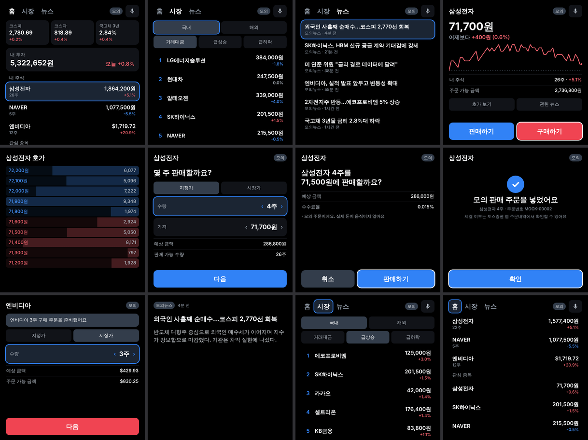

# Toss Sec Glasses

**Meta Ray-Ban Display**에서 돌아가는 토스증권 웹앱입니다. 지수, 시장 랭킹, 뉴스, 시세를 한눈에 보고,
**Neural Band 제스처**나 **음성**으로 주식을 사고팔 수 있어요. 데이터는 [토스증권 Open API](https://corp.tossinvest.com/ko/open-api)에서 받아요.

> ⚠️ 개인 프로젝트입니다. 토스증권 공식 앱이 아니에요. 기본값은 **모의 모드**라서 실제 돈이 움직이지 않아요.

<p align="center"></p>

## 구조

```
 ┌──────────────────────┐   HTTPS + Bearer      ┌─────────────────────────┐   OAuth2 + IP 허용목록   ┌──────────────────┐
 │  glasses/ (웹앱)      │ ───────────────────▶ │  server/ (BFF)          │ ─────────────────────▶ │ 토스증권 Open API │
 │  React · 600×600     │   /api/*              │  키 보관 · 캐시 · 주문 가드 │                         └──────────────────┘
 │  Neural Band · 음성   │ ◀─────────────────── │  모의 모드 내장           │ ─────▶ Naver 뉴스 API (선택)
 └──────────────────────┘   작은 JSON          └─────────────────────────┘
```

**왜 서버(BFF, Backend for Frontend)를 두나요?** 웹앱의 JS는 누구나 열어볼 수 있어요. 그래서 `client_secret`을 넣으면
그대로 유출됩니다. 그리고 토스증권은 **등록된 IP에서 온 요청만** 받아요. 안경은 고정 IP가 없어서 직접 호출할 수 없어요.
서버는 그 밖에도 세 가지를 해요. 응답을 안경 화면에 맞게 줄이고(링크 속도가 약 500Kbps), 여러 화면의 같은 요청을
하나로 합쳐 rate limit을 아끼고, 주문 안전장치를 걸어요.

## 조작법

| 입력 | 웹 이벤트 | 동작 |
|---|---|---|
| 엄지 스와이프 ↑↓ | `ArrowUp/Down` | 위아래 행 이동 (목록은 자동 스크롤) |
| 엄지 스와이프 ←→ | `ArrowLeft/Right` | 같은 행 안에서 이동 · 행 끝에서는 탭 전환 · 수량/가격 칸에서는 값 조절 |
| 검지 핀치 | `Enter` → `click` | 선택 |
| 뒤로 제스처 | `Escape` | 이전 화면 (주문 확인 단계에서는 입력 단계로) |
| 🎙 버튼 핀치 | 시스템 음성/손글씨 입력 | 명령 실행 |

**음성 명령 예시:** "삼성전자 10주 구매", "애플 세 주 사줘", "엔비디아 시장가로 5주 매수", "카카오 2주 팔아",
"테슬라 주가", "급상승", "해외 급하락", "삼성전자 뉴스", "홈"

음성으로 하는 주문은 항상 **주문 화면을 미리 채워두기만** 해요. 실제 주문은 마지막에 핀치로 확인해야 나가요.

## 주문 안전장치 (`server/src/orders.ts`)

1. **주문 티켓 (preview ticket).** 확인 화면을 띄울 때 서버가 주문 내용을 저장하고 티켓을 발급해요.
   확인할 때는 티켓만 보내요. 그래서 화면에서 본 주문과 실제로 나가는 주문이 항상 같아요.
2. **멱등성 (idempotency).** 티켓이 곧 토스증권 `clientOrderId`예요. 두 번 핀치하거나 네트워크가 재시도해도 주문은 한 번만 나가요.
3. **확인 버튼 지연 (arming).** 확인 버튼은 0.9초 뒤에 눌려요. 앞 화면에서 한 핀치가 확인 버튼으로 넘어와도 무시돼요.
4. **서버 가드.** 실거래 스위치 `TRADING_ENABLED`(기본 꺼짐), 1회 주문 한도 `MAX_ORDER_KRW`(기본 100만 원),
   호가 단위 검사, 현재가와 10% 넘게 차이 나는 지정가 차단(fat-finger 방지)이 있어요.

## 실행하기

```bash
# 1) 서버 (모의 모드: 키 필요 없음)
cd server && npm install && npm start            # :8787

# 2) 안경 앱 (다른 터미널)
cd glasses && npm install && npm run dev         # http://localhost:5173  (/api → :8787 프록시)
```

브라우저 창을 600×600으로 두고 방향키, Enter, Esc로 조작하면 Neural Band 입력과 같아요. Chrome에서는 `v` 키를 누르면 받아쓰기로 음성 명령을 시험할 수 있어요.

```bash
cd server && npm test        # 주문 가드 · 토큰 캐시 테스트
cd glasses && npm test       # 음성 명령 파서 테스트
```

### 실계좌 연결 (live)

1. 토스증권 WTS → 설정 → Open API에서 `client_id`/`client_secret`을 발급받고, **서버의 공인 IP**를 허용 목록에 넣어요.
2. `server/.env.example`을 `server/.env`로 복사하고 `APP_MODE=live`, 키, `DEVICE_TOKEN`을 채워요.
3. `cd glasses && npm run build` 후 `STATIC_DIR=../glasses/dist node --env-file=.env src/index.ts`
   → 서버 하나가 앱과 API를 같이 서빙해요. 고정 IP가 있는 VPS 같은 곳에 HTTPS로 올려요.
4. 안경에서 `https://<host>/#pair=<DEVICE_TOKEN>`을 한 번 열어 페어링해요. 토큰은 기기에 저장되고 주소창에서는 지워져요.
5. 시세가 잘 나오는지 확인한 뒤에만 `TRADING_ENABLED=true`로 바꿔요.

## 디자인 메모

- **TDS 색과 타이포를 additive display에 맞게 조정했어요.** 렌즈에서는 검정이 투명이에요. 그래서 배경은 TDS 다크 서피스(#17171C)
  대신 순수 검정을 쓰고, 빛나는 면적은 카드와 포커스 정도로 줄였어요. 상승은 빨강, 하락은 파랑(국내 관례)이고, 숫자는 tabular-nums로 표시해요.
- **Meta UI Toolkit은 쓰지 않았어요 (custom-UI opt-out).** Toss 디자인 언어를 따르려고 자체 컴포넌트를 만들었어요. 대신 Meta가
  정한 600×600 고정 캔버스 규칙을 지키고, 공식 품질 게이트(`check-webapp.mjs`)를 통과했어요.
  결과: 번들 69KB gzip, 요청 6개, 로드 0.2초, 힙 3.7MB.
- 포커스 엔진은 `glasses/src/nav/focus.ts`에 있어요. 좌표가 아니라 `data-row`로 행과 열 구조를 선언하는 방식이에요.

## 아직 확인하지 못한 것 / 한계

- **실기기 테스트를 아직 못 했어요.** 입력 매핑은 Meta 공식 스타터킷 문서를 따랐어요.
- **실계좌 호출도 아직 검증하지 못했어요.** 코드는 토스증권 OpenAPI 1.2.x 스펙에 맞춰 짰지만 실제 키로 돌려보지는 않았어요.
  특히 등락률은 `/prices`에 없어서 일봉 2개로 전일 종가를 추정해요.
- 지수는 API가 주는 **코스피, 코스닥, 국고채**만 있어요. 나스닥과 S&P는 없어요. 뉴스도 토스 API에 없어서 Naver 검색 API를 써요.
- 해외 소수점 주문, 조건 주문, 실시간 WebSocket(`wss://openapi-ws.tossinvest.com`)은 아직 안 붙였어요. 지금은 폴링이고, 앱이 숨겨지면 멈춰요.
- 한글 웹폰트는 넣지 않았어요(1MB 이상이라 예산 초과). 기기의 시스템 폰트에 한글이 있는지 실기기에서 확인이 필요해요.
- 토스·토스증권 이름과 로고는 각 회사의 상표예요. 배포하려면 권리 확인이 필요해요.
